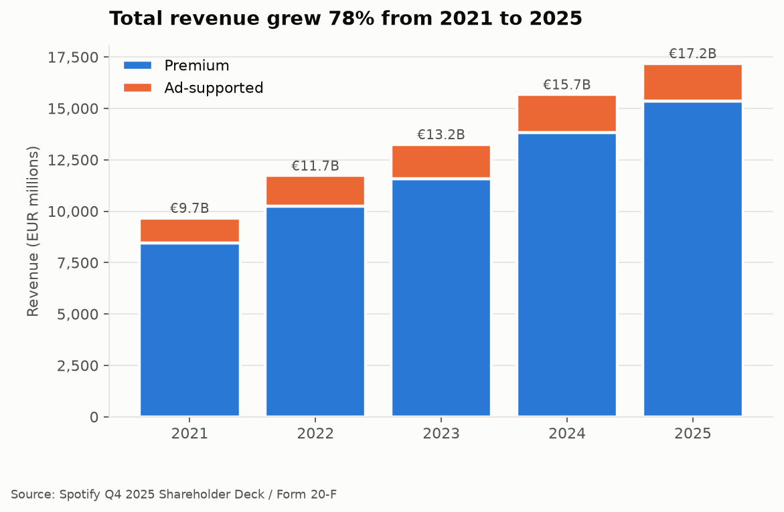
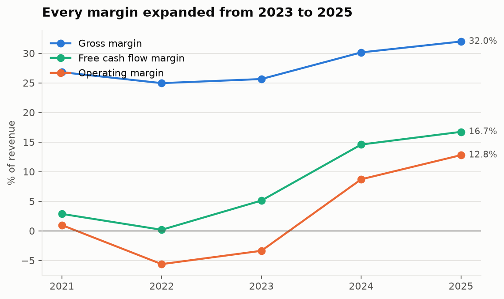
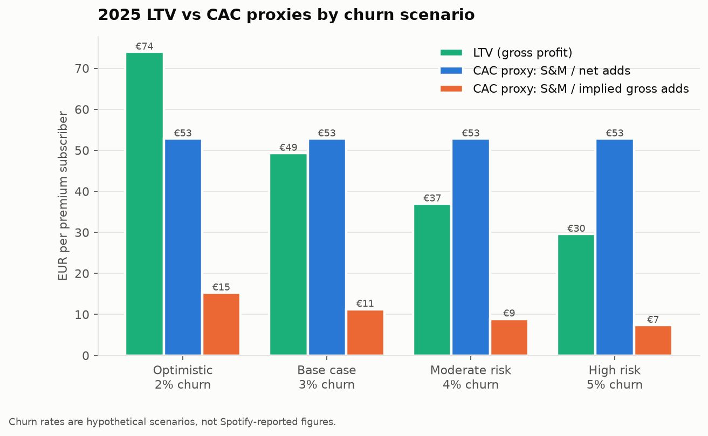
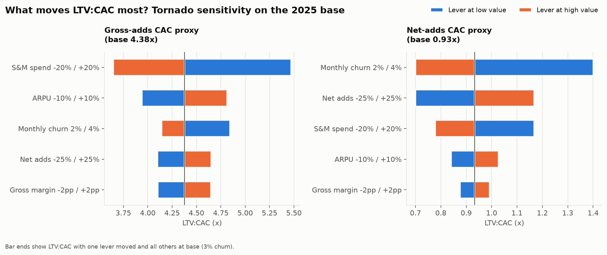

# Spotify Historical Financial & Unit Economics Analysis (2021-2025)

An end-to-end finance and data analysis of Spotify's reported results. It covers revenue, subscriber economics,
profitability, marketing efficiency, and a scenario-based LTV / CAC model, built with **Python, Excel and Power BI**.

> All inputs are from Spotify's public investor materials. Churn rates and CAC figures are **analyst scenarios and
> proxies**, because Spotify discloses neither.

## Key findings

| Question | Answer |
| --- | --- |
| Is revenue growing faster than subscribers? | Over 2021-2025, yes: revenue **+78%** vs premium subscribers **+61%**. Year by year it is mixed (faster in 2022 and 2024). |
| Revenue per premium subscriber? | About **€4.63 / month** in 2025, up from €4.44 in 2022. |
| Is Spotify becoming more profitable? | Yes. Operating margin went from **-5.6% (2022) to 12.8% (2025)**, and free cash flow from €21M to €2.9B. |
| Marketing efficiency? | S&M fell from **11.6% to 8.3% of revenue** (2023-2025) while net adds held at about 27M a year. |
| Premium LTV? | About **€49** of gross profit at an assumed 3% monthly churn (range €30-€74 at 2-5% churn). |
| LTV sensitivity to churn? | High: going from 2% to 5% churn cuts LTV by 60%. |
| CAC payback? | It depends on the proxy: **7.6 months** (churn-consistent gross-adds proxy, LTV:CAC 4.4x) vs 36 months (S&M / net adds, LTV:CAC 0.9x). |
| Biggest opportunities | Retention, gross-margin expansion, and ad monetisation: ad revenue per ad-supported MAU fell from €5.56 to €4.08 (2022-2025). |

Full write-up: [`outputs/reports/Spotify_Management_Report.md`](outputs/reports/Spotify_Management_Report.md)






## Project structure

```
Spotify_Historical_Unit_Economics/
├── data/
│   ├── raw/                     # Reported data (CSV) + source workbook
│   ├── processed/               # Clean data, analysis tables, validation log
│   ├── data_dictionary.csv
│   └── source_register.csv
├── notebooks/                   # Analysis scripts, run in numeric order
│   ├── common.py                # Paths, chart style, shared unit-economics formulas
│   ├── 00_extract_raw_data.py
│   ├── 01_data_quality_and_eda.py
│   ├── 02_revenue_analysis.py
│   ├── 03_subscriber_analysis.py
│   ├── 04_profitability_analysis.py
│   ├── 05_unit_economics.py
│   ├── 06_scenario_analysis.py
│   ├── 07_business_recommendations.py
│   ├── 08_build_excel_model.py
│   └── 09_export_powerbi_data.py
├── outputs/
│   ├── charts/                  # 19 PNG charts
│   ├── financial_models/        # Spotify_Unit_Economics_Model.xlsx
│   └── reports/                 # Phase reports + management report
├── dashboards/                  # Power BI data, DAX measures, theme, build guide
├── run_pipeline.py
└── requirements.txt
```

## How to run

```bash
pip install -r requirements.txt
python run_pipeline.py
```

This regenerates every processed table, chart, report, the Excel model and the Power BI tables from
`data/raw/source/Spotify_Historical_Data.xlsx`.

### Interactive Python dashboard

```bash
python dashboards/dashboard.py      # then open http://127.0.0.1:8050
```

A fully coded Python dashboard (Plotly Dash: layout, styling and callbacks are all in Python) in a SaaS-analytics
style:
- **Navigation:** a dark sidebar menu with Dashboard, a Reports group (Revenue, Subscribers, ARPU, Profitability,
  CAC, LTV, Retention, Sensitivity) and Data.
- **Pages:** each has its own URL (e.g. `/retention`), underlined sub-tabs, a Filter panel, and a CSV download of
  the page's data.
- **KPI cards:** sparklines and coloured change pills.
- **Cohort-style heat tables:** modeled subscriber retention and gross-profit payback by month, quarter or year, and a
  two-way sensitivity grid. Each has dropdown controls.
- **Filters:** churn, ARPU, gross margin, S&M spend and net adds recalculate every unit-economics view live, using
  the same `unit_economics()` function as the analysis scripts.

## Methodology

| Metric | Formula |
| --- | --- |
| Growth | (Current - Previous) / Previous |
| Monthly premium ARPU | Premium revenue / avg(opening, closing subscribers) / 12 |
| Gross / operating margin | Gross profit or operating income / revenue |
| Operating expense ratio | Operating expenses / revenue |
| CAC proxy 1 (roadmap) | S&M expense / net premium additions |
| CAC proxy 2 (churn-consistent) | S&M / (net adds + avg subscribers x monthly churn x 12) |
| LTV | Monthly ARPU x gross margin / monthly churn |
| LTV:CAC | LTV / CAC proxy |
| Payback (months) | CAC proxy / (monthly ARPU x gross margin) |

**Why two CAC proxies?** Dividing S&M by *net* adds treats every new subscriber as pure growth, which implicitly
assumes zero churn. That contradicts the churn assumption used in LTV. Proxy 2 adds back the subscribers that the
assumed churn rate would need replacing, so LTV and CAC rest on the same assumption.

### Data validation

79 automated checks run on the source data, and all pass (`data/processed/validation_checks.csv`). They cover:
segment revenue sums, reported vs recomputed margins, the gross profit -> operating income bridge, 2025 quarterly
vs annual totals, Q4 vs year-end subscriber stocks, and re-derivation of every supplied analyst column.

### Excel model

[`outputs/financial_models/Spotify_Unit_Economics_Model.xlsx`](outputs/financial_models/Spotify_Unit_Economics_Model.xlsx)
has 8 sheets: Raw_Data -> Revenue_Analysis -> Subscriber_Analysis -> Profitability -> CAC_Analysis -> LTV_Model ->
Scenario_Analysis -> Executive_Summary.

- Every analysis cell is a live formula.
- Inputs (blue on yellow) on `LTV_Model` set base year, churn, and ARPU / margin / S&M / net-adds adjustments.
  Scenario rows and the two sensitivity grids are also editable.
- The workbook's formulas were recalculated independently and match the Python outputs (121/121 values).

### Power BI

`dashboards/` contains the model tables, the DAX measures (including what-if parameters for live LTV:CAC), a theme,
and a page-by-page build guide for the four dashboard pages. See
[`dashboards/POWERBI_BUILD_GUIDE.md`](dashboards/POWERBI_BUILD_GUIDE.md).

## Limitations

- Churn is hypothetical (2-5% monthly scenarios). Spotify does not disclose it.
- CAC figures are proxies that charge all S&M to premium acquisition. S&M data covers 2023-2025 only.
- ARPU is an approximation, not Spotify's reported metric. LTV uses company-level gross margin, is undiscounted,
  and holds inputs constant.
- Five annual observations: trends are descriptive, not statistically tested. Figures are in reported EUR, not
  constant currency.

## Sources

- [Spotify Q4 2025 Shareholder Deck](https://s29.q4cdn.com/175625835/files/doc_financials/2025/q4/Q4-2025-Shareholder-Deck-FINAL.pdf)
- [Spotify Form 20-F 2025 (SEC)](https://www.sec.gov/Archives/edgar/data/1639920/000162828026006874/ck0001639920-20251231.htm)
- [Spotify Investor Relations: Financials](https://investors.spotify.com/financials/default.aspx)
